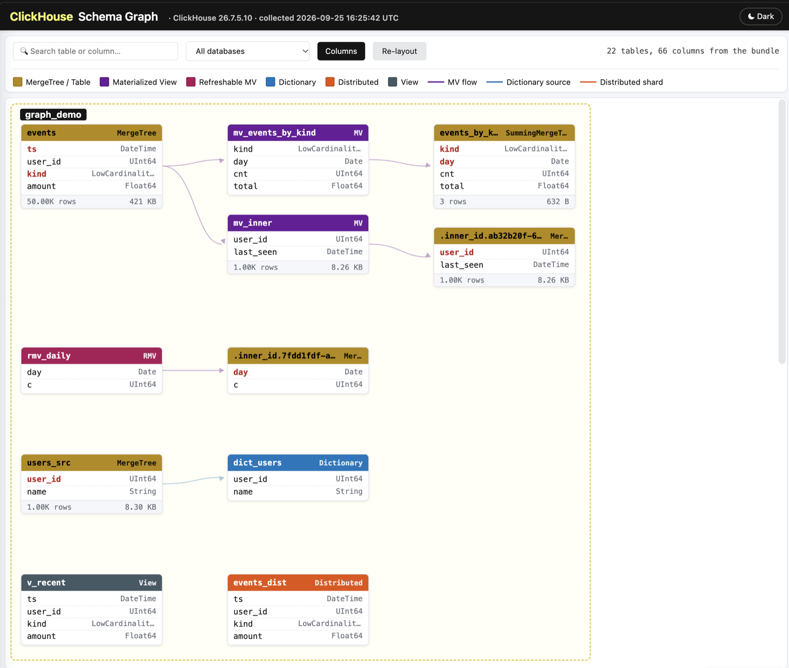

# ClickHouse 诊断工具

## 这个工具用来做什么

当 ClickHouse 服务器出现异常时——insert 被拒绝、查询耗尽内存、replica（副本）变为只读、磁盘被写满、Keeper 变慢——答案就在它的 `system` 表、日志以及它运行所在的主机里。`clickhouse-diagnostic` 会**以一条命令、只读地一次性**采集这些证据，并打包成单个 `clickhouse_diagnostic_<timestamp>.tar.gz`：可以留存、交给支持团队、作为 dashboard（仪表盘）打开，或者交给懂得如何阅读它的 AI 助手。

它的设计目标就是**在已经出问题的服务器上运行**。开始采集前，一个耗时一秒的探针会检查服务器，并决定采集多少数据：

| `-collect` | 作用 | 何时使用 |
|---|---|---|
| `auto` *（默认）* | 健康服务器上执行完整采集，吃力的服务器上只采集 essential；如果运行中查询开始超时，会切换到 essential | 几乎所有情况 |
| `full` | 全部内容，使用正常的回溯窗口（每张表 7、3 或 1 天） | 服务器健康、且你想要完整全貌时 |
| `essential` | 只采集廉价而关键的表格，1 天窗口，较短超时，3 分钟预算，温和的查询设置 | 节点过载、内存耗尽或 Keeper 失联时 |

**工作原理。** 每条查询都是针对 `system` 表的只读 `SELECT`——绝不会读取客户数据行。结果会写成文件，随后 alert rule（告警规则）和 dashboard 都**基于这些文件**构建：采集结束后不会再向服务器索取任何东西。配置文件被复制时会移除凭据；当 bundle（诊断包）必须离开组织时，`gov` 模式会对每个标识符做哈希。

## 快速开始

从 [Releases](https://github.com/ClickHouse/clickhouse-diagnostics/releases/latest) 下载对应平台的压缩包，解压后从解压出的文件夹中运行（该文件夹包含可执行文件，以及它读取的 `queries.*` 和 `alerts/` 文件夹）。先创建只读用户——参见[所需的 grant（授权）](#所需的-grant授权)。

```bash
export CLICKHOUSE_PASSWORD='…'     # 未提供 -password 时读取；不会出现在 ps 和 shell 历史中

# 自管理节点：在服务器上运行，这样 host facts（主机信息）、日志和配置也会被采集
./clickhouse-diagnostic -mode onprem -host localhost -user sys_read_only

# 一个 ClickHouse Cloud 服务
./clickhouse-diagnostic -mode cloud -host <service>.<region>.aws.clickhouse.cloud -port 8443 -protocol https -user sys_read_only

# 对标识符做哈希，用于必须离开组织的 bundle（诊断包）
./clickhouse-diagnostic -mode gov -host ch-01 -user sys_read_only -salt <YourPrivateSalt>
```

每次运行都会在 `clickhouse_results/`（与解压后的文件夹相邻）留下 `clickhouse_diagnostic_<ts>.tar.gz`。先打开该文件夹中的 **`dashboard.html`**，然后用 [AI skill（AI 技能）](#用-ai-skill-排查问题) 解读 bundle。

## 所需的 grant（授权）

```sql
CREATE USER sys_read_only IDENTIFIED WITH sha256_password BY '<password>';
GRANT SHOW DATABASES, SHOW TABLES, SHOW COLUMNS ON *.* TO sys_read_only;
GRANT SELECT ON system.* TO sys_read_only;
```

**Cloud 模式**还需要 `GRANT REMOTE, CREATE TEMPORARY TABLE ON *.* TO sys_read_only`（它的查询通过 `clusterAllReplicas` 读取每个 replica）。

<details>
<summary>为什么需要这些 grant（授权），以及缺少某一个时的表现</summary>

- `SELECT ON system.*` —— 每条查询都会读取一张 `system` 表；绝不会查询其他内容。
- `SHOW …` —— ClickHouse 只会列出用户拥有*某种*权限的对象。缺少这些授权，运行仍会成功，但 bundle 会悄悄地只描述服务器的一小部分。如果 `system.databases` 中只有 `system`，说明缺少该 grant。
- 不要改用对数据数据库授予 `SELECT`：那样采集到的 bundle 相同，却会让诊断用户获得对客户数据的读权限。
- 配置、host facts 和日志从本地文件系统读取，因此需要操作系统层面的读权限，而不是 grant。

细节与实测数据：[docs/running.md](docs/running.md#必需的-grant授权)。
</details>

## 示例

```bash
export CLICKHOUSE_PASSWORD='…'          # 未提供 -password 时读取；不会出现在 ps 和 shell 历史中

# ── 采集多少 ─────────────────────────────────────────────────────
# auto（默认）：健康服务器上采集 full，吃力的服务器上采集 essential。
# 运行会打印它选择了什么以及原因，例如
#   "essential collection（精简采集），自动选择：8 核上的 load average 为 26.6"
./clickhouse-diagnostic -mode onprem -host localhost -user diag

# 强制采集全部内容，无论负载如何（在节点恢复健康之后）
./clickhouse-diagnostic -mode onprem -host localhost -user diag -collect full

# 强制使用轻量版本：廉价表、1 天窗口、每条查询 30 秒、总计 3 分钟
./clickhouse-diagnostic -mode onprem -host localhost -user diag -collect essential

# 出问题的节点，分秒必争：更紧的预算和超时
./clickhouse-diagnostic -mode onprem -host localhost -user diag -collect essential -time-budget 90s -query-timeout 20s

# ── 已知时间点的故障 ─────────────────────────────────────────────
# -from / -to 会替换每张表的默认回溯窗口；告警和
# dashboard 随后判断该窗口。几小时的窗口也是最省成本的运行方式。
./clickhouse-diagnostic -mode onprem -host ch-01 -user diag -from 2026-08-14T09:00:00Z -to 2026-08-14T13:00:00Z

# 或者加宽每个窗口：自 7 月 21 日以来的全部内容
./clickhouse-diagnostic -mode onprem -host ch-01 -user diag -from 2026-07-21

# ── 整个集群 ─────────────────────────────────────────────────────────
# 向一个节点询问主机列表，展示计划，然后依次采集每个主机。
# 每个主机在 cluster_bundles_<ts>/ 中各有一个 bundle；每个主机自行选择模式。
./clickhouse-diagnostic cluster -user diag
./clickhouse-diagnostic cluster -user diag -yes                       # 不弹出确认提示
./clickhouse-diagnostic cluster -user diag -collect-from each-node    # 打印要在每个主机上运行的命令
                                                                      # （会附带该主机的服务器日志和配置）

# ── 一条缓慢或失败的查询 ───────────────────────────────────────────────
# 来自工单的 query_id：它的详情、ProfileEvents 和日志行，并与
# 同一查询形态的快慢运行作对比（前后 48 小时）
./clickhouse-diagnostic -mode onprem -host ch-01 -user diag -query-id 3f2c9a6e-5b1d-4c8a-9e7f-2a4b6c8d0e1f

# 本周出现回退的查询形态（normalized_query_hash）：自动挑选
# 最慢的一次执行，并与其余执行作对比
./clickhouse-diagnostic -mode onprem -host ch-01 -user diag -normalized-query-hash 7769688026807387533 -from 2026-10-26

# 两者同时使用，并指定显式窗口
./clickhouse-diagnostic -mode onprem -host ch-01 -user diag -query-id 3f2c9a6e-5b1d-4c8a-9e7f-2a4b6c8d0e1f \
  -normalized-query-hash 7769688026807387533 -from 2026-10-30T08:00:00Z -to 2026-10-30T12:00:00Z

# ── Cloud 与 gov ───────────────────────────────────────────────────────────
./clickhouse-diagnostic -mode cloud -host <service>.<region>.aws.clickhouse.cloud -port 8443 -protocol https -user diag
./clickhouse-diagnostic -mode gov -host ch-01 -user diag -salt <YourPrivateSalt>    # 名称做哈希；不生成 dashboard

# ── 之前与之后 ────────────────────────────────────────────────────────
./clickhouse-diagnostic -mode onprem -host ch-01 -user diag -dry-run    # 列出每条 SELECT 及其 EXPLAIN ESTIMATE；不采集任何内容
./clickhouse-diagnostic -mode onprem -host ch-01 -user diag -airgap     # 无需联网即可打开的 dashboard
```

每次运行都会打印它写出的归档（`clickhouse_results/clickhouse_diagnostic_<ts>.tar.gz`）。essential 的选择也会体现在 `execution_log.txt` 的 `collect:` 行，以及 `dashboard.html` 的横幅中，横幅会列出哪些内容被跳过。更多内容：[docs/running.md](docs/running.md#示例)、[`cluster-collect/`](cluster-collect/README.md)、[查询分析](#查询分析)、[`airgap/`](airgap/README.md)。

## 用 AI skill 排查问题

`skills/clickhouse-diagnostic/` 教会 AI 助手——Claude Code、Codex CLI，或任何会读取 `SKILL.md` / `AGENTS.md` 的助手——像 ClickHouse 支持工程师那样阅读 bundle。它会检查 bundle 覆盖了哪些内容、运行健康检查、把 finding（发现）与一份取自真实升级事件的 ClickHouse 常见故障模式目录进行匹配，并写出一份简短摘要，其中**每个 finding 都会引用 `file → column → value`**，附上建议的修复方法，以及当 bundle 无法回答问题时精确的重新采集命令。

**启动它。** 在 Claude Code 中打开此仓库（skill 会被自动发现），然后运行：

```
/clickhouse-diagnostic ~/Downloads/clickhouse_diagnostic_20261102_160031.tar.gz
```

Codex 通过 `AGENTS.md` 找到它。如果从其他文件夹使用，请把 `skills/clickhouse-diagnostic` 复制或建立符号链接到你的助手的 skills 目录中。

**可以这样提问：**
- *"分析这个 bundle ——为什么 insert 会以 TOO_MANY_PARTS 失败？"*
- *"Keeper 是瓶颈吗？是哪个 replica、哪个组件，从什么时候开始？"*
- *"这个 replica 处于只读状态——发生了什么，客户应该怎么做？"*
- *"要确认这一点，我应该重新采集什么？"*——它会给出命令。

**它了解我们见过的故障。** 该 skill 携带一份包含近 50 种常见 ClickHouse 故障的目录，每种都说明在 bundle 中会看到什么、通常意味着什么、如何验证，以及有效的修复方法——均取自真实升级事件并做了匿名化。当证据匹配时，摘要会指明对应的模式。例如，在一个所有 replica 都变为只读的 bundle 上：

> **Keeper 没有 leader，因此所有复制表都处于只读状态**——类似 P-61。
> `keeper/keeper2_9181.txt` → `mntr` `zk_latest_snapshot_size` = 2.4 GiB，而 `conf` `snapshot_transfer_chunk_size=0`；它的 `lgif` `last_log_idx` 低于 leader 的 `first_log_idx`；三个成员都回答 *"not currently serving requests"*。
> 落后的成员只能通过 snapshot 追赶，而超过 2 GiB 的 snapshot 无法一次性传输成功，因此每个新 leader 都会在几秒内失去领导权。
> **修复：** 保持落后成员停止运行，同时重启状态最新的成员，让它们仅凭自己的日志组成 quorum。然后在每个成员上设置 `snapshot_transfer_chunk_size` 和 `nuraft_snapshot_sync_ctx_timeout_ms`——两者都需要重启，因此先重启提供服务的成员，期间暂停写入——最后才启动落后的成员。

它还能识别其他 Keeper 模式：quorum 丢失后的会话过期级联、某个 replica 的 Keeper 请求变慢而其同级 replica 正常、磁盘元数据 znode 不断堆积直到 Keeper 内存耗尽、某个后台任务在 Keeper 上反复循环。part、merge、内存、mutation、磁盘和 insert 也是如此。

该 skill 离线工作，绝不修改或上传 bundle；任何内容离开本机之前都会执行隐私检查（[`privacy.md`](skills/clickhouse-diagnostic/references/privacy.md)）。

## 采集了什么，以及为什么

<details>
<summary>展开</summary>

约 60 个 collector（采集器），全部来自 `system` 表或 host facts：

- **Part、merge 与 mutation**——每个分区和每张表的 part 数量、merge 与 mutation 积压、三天的 part 事件。
- **复制与 Keeper**——replica 健康状况、replication queue（复制队列）、Keeper 会话与请求计数器、每个 Keeper 成员对自身的报告，以及（26.3+）谁向 Keeper 发送了哪些请求、何时、走哪些路径。
- **查询**——按小时和按查询形态统计的七天活动、按错误码统计的失败、最慢和最重的查询形态。
- **错误与日志**——错误计数器及其历史、`text_log` 中按严重级别优先截取的部分、服务器日志文件（on-prem）。
- **资源**——后台池、每小时的内存和 CPU；磁盘、detached part（分离 part）、对象存储。
- **Schema 与设置**——表、列、字典、materialized view（物化视图）、集群；与默认值不同的设置；移除凭据后的配置文件。
- **主机**（on-prem）——操作系统、CPU、内存、磁盘，以及 ClickHouse 给出警告的内核设置。

每个文件、它回答的问题以及它为何出现在 bundle 中：[docs/collectors.md](docs/collectors.md)。
</details>

## 模式（`-mode onprem | cloud | gov`）

<details>
<summary>展开</summary>

- **`onprem`**——单台自管理服务器；在服务器上运行它，还会采集 host facts、日志、配置以及 Keeper 自身的回答。SharedMergeTree 集群会被检测到，并跨其 replica 采集。
- **`cloud`**——一个 ClickHouse Cloud 服务；每张按 replica 区分的表都会在所有 replica 上读取（`clusterAllReplicas`）。
- **`gov`**——与 `onprem` 类似，但会用你的私有 salt 对数据库、表、用户和主机名做哈希；不包含 dashboard、查询文本、配置、host facts 或日志。salt 和名称映射文件绝不离开你的机器。

细节：[docs/modes.md](docs/modes.md)。
</details>

## 命令行 flag

<details>
<summary>最常用的 flag</summary>

| Flag | 作用 |
|---|---|
| `-mode onprem\|cloud\|gov` | 服务器类型（参见[模式](#模式-mode-onprem--cloud--gov)） |
| `-host`, `-port`, `-protocol`, `-user` | 连接到哪里；密码来自 `CLICKHOUSE_PASSWORD` 或交互式提示 |
| `-collect auto\|full\|essential` | 采集多少数据（参见[这个工具用来做什么](#这个工具用来做什么)） |
| `-from`, `-to` | 采集这个窗口，替代每张表的默认回溯窗口 |
| `-time-budget`, `-query-timeout` | 限制整次运行和每条查询 |
| `-query-id`, `-normalized-query-hash` | 增加对单条查询的聚焦分析 |
| `-dry-run` | 列出将要运行的内容；不采集任何内容 |
| `-output-dir` | 结果输出位置（默认 `./clickhouse_results`） |
| `-salt` | Gov 模式哈希用的 salt |
| `-airgap` | 无需联网即可打开的 dashboard |
| `-skip-config`, `-skip-alerts`, `-skip-dashboard`, `-skip-archive` | 跳过某个步骤 |

全部 flag：`./clickhouse-diagnostic -help`，或 [docs/running.md](docs/running.md#命令行-flag)。
</details>

## 采集模式详解

<details>
<summary>auto 如何决策，以及 essential 改变了什么</summary>

`auto` 会运行一个短探针（只查内存表），并在以下情况采集 essential：`SELECT 1` 耗时超过 1 秒、`system.metrics` 超过 2 秒、运行中的查询达到 `max_concurrent_queries` 的 80 %、内存达到服务器上限的 90 %、负载平均值超过核心数的两倍，或复制表处于只读状态。full 运行也会在运行中切换到 essential：某条查询超时，或连续两条查询耗时超过 30 秒。

essential 只运行标记为 `-- tier: essential` 的 collector，把每个 3 天和 7 天窗口都压缩到 1 天，设置每条查询 30 秒超时和 3 分钟预算，并以 `max_threads = 2`、`max_memory_usage = 1 GiB` 和最低优先级运行。Keeper 失联时，会跳过那些需要等待会话的查询。

细节：[docs/running.md](docs/running.md#essential-或-full-采集-collect)。
</details>

## 采集窗口

<details>
<summary>展开</summary>

每个 collector 都有自己的默认回溯窗口：`query_log`、`metric_log` 和大多数日志表为 7 天，`part_log` 和少数宽表为 3 天，`text_log` 和 Keeper 日志为 1 天。`-from` / `-to` 会一次性替换所有这些窗口；两者可以只给其中一个。告警规则保留自己的回溯窗口（例如"最近一小时"），在已采集的文件范围内度量。

每个 collector 的窗口：[docs/running.md](docs/running.md#采集窗口)。
</details>

## Schema graph（模式关系图）



每次 `onprem` 和 `cloud` 运行还会写出 **`schema_graph.html`**：一张交互式地图，展示数据如何在 schema 中流动——表、materialized view、字典和 Distributed 表，边从源指向目标。点击节点可查看其键、列、邻居和 `CREATE` 语句；支持搜索、过滤和拖拽。它直接从磁盘工作，无需服务器或网络，可从 dashboard 的 *Schema Graph* 标签页打开。细节：[docs/dashboard.md](docs/dashboard.md#schema-graph模式关系图)。

## Dry-run（试运行）

<details>
<summary>展开</summary>

`-dry-run` 会打印该工具将发送的每条 `SELECT`、每条查询涉及的 system 表，以及只读的 `EXPLAIN ESTIMATE`（它将扫描的行数和 part 数），然后退出，不采集也不写入任何内容。细节：[docs/running.md](docs/running.md#dry-run试运行模式)。
</details>

## 告警

<details>
<summary>展开</summary>

`alerts/` 中的 19 条只读规则会在任何人阅读文件之前给出 headline（概要）——part 过多、replica 只读、Keeper 不可用或反复抖动、后台池饱和、merge 失败、磁盘空间不足、崩溃、长时间运行的 mutation、异常尖峰等等。每条规则都在已采集的文件上求值；它的 SQL 会显示在 dashboard 中，供客户在自己的集群上运行。如果某条规则所需的数据未被采集，它会显示 *not applicable*，绝不会显示为 clean。

规则、结果以及如何新增一条规则：[docs/alerts.md](docs/alerts.md)。
</details>

## Dashboard（仪表盘）

<details>
<summary>展开</summary>

`dashboard.html` 是一个自包含的单页：告警、存储、查询活动、复制、Keeper 健康、后台池、磁盘、日志、host facts，以及（按需）查询分析。它由 bundle 的文件构建而成，会说明本次属于哪种采集以及缺少什么，并可直接从磁盘打开。gov 模式不生成它。

各分区与预览：[docs/dashboard.md](docs/dashboard.md)。
</details>

## 查询分析

<details>
<summary>展开</summary>

`-query-id` 或 `-normalized-query-hash` 会为单条查询增加 12 个聚焦的 collector：它的详情和 ProfileEvents、它的日志行、它读取的表、它与快慢同级执行的对比，以及它随时间发生的失败。gov 模式下不可用。

细节：[docs/query-analysis.md](docs/query-analysis.md)。
</details>

## Host facts（主机信息）、Keeper 与服务器日志

<details>
<summary>展开</summary>

在服务器上运行的 on-prem 采集还会收集 `host_info.json`（操作系统、内核、CPU、内存、磁盘、限制）、服务器日志文件（尾部截断），以及每个 Keeper 成员通过其只读 four-letter command（四字命令）报告的自身信息。cloud 运行会跳过这些；gov 只保留 Keeper 的数字。

细节：[docs/bundle.md](docs/bundle.md#host-facts主机信息与服务端日志)。
</details>

## 配置采集

<details>
<summary>展开</summary>

On-prem 模式下会复制 `/etc/clickhouse-server/`，其中密码、密钥、token 和证书会被替换——主机名、IP 和拓扑保留，因此共享前请先审阅。cloud 和 gov 运行不采集它。

细节：[docs/bundle.md](docs/bundle.md#配置采集)。
</details>

## 输出结构

<details>
<summary>展开</summary>

每次运行在 `clickhouse_results/` 中有一个文件夹，外加其 `.tar.gz`：每个 collector 一个 `<collector>_<ts>.jsonl`，`execution_log.txt`（每条查询的结果、耗时和大小），`dashboard.html`、`schema_graph.html`，以及 `configuration/`、`logs/`、`keeper/` 和 `host_info.json` 这些附加内容。

细节：[docs/bundle.md](docs/bundle.md#输出布局)。
</details>

## 支持的版本

<details>
<summary>展开</summary>

on-prem 和 gov 模式支持 ClickHouse **22.8 及更新版本**；覆盖所有 ClickHouse Cloud 版本。较新的列和表位于版本子目录（`queries.<mode>/MAJOR.MINOR.PATCH.BUILD/`）中，按所连接的服务器选择。

细节：[docs/versions.md](docs/versions.md)。
</details>

## 从源码构建

<details>
<summary>展开</summary>

```bash
make build      # → ./bin/clickhouse-diagnostic
make test
make release    # 所有平台，静态二进制，输出到 ./bin/
```

Go 1.23+。细节：[docs/building.md](docs/building.md)。
</details>

## 故障排查

<details>
<summary>展开</summary>

最常见的意外：bundle 看起来完整，却缺少客户的表（缺少某个 `SHOW` grant）；cloud 模式下出现 `Code: 497`（缺少 `REMOTE` / `CREATE TEMPORARY TABLE`）；以及某个 collector 失败——每次失败都会连同服务器的错误一起列在 `execution_log.txt` 中。

细节：[docs/troubleshooting.md](docs/troubleshooting.md)。
</details>

## 输出格式、边界与大小

<details>
<summary>展开</summary>

结果默认是 JSONEachRow（`-output-format jsonl`；也支持 `native` 和 `tsv`，使用它们时告警和 dashboard 会查询服务器）。每条查询都在服务器端有界，64 位整数以字符串形式写出，因此绝不会被舍入；bundle 通常为几十 MB——包含服务器日志时更大（每个文件上限 50 MiB）。

细节：[docs/bundle.md](docs/bundle.md#输出格式)。
</details>

## 文档

| 页面 | 内容 |
|---|---|
| [docs/collectors.md](docs/collectors.md) | 每个被采集的文件：它回答的问题，以及它为何在 bundle 中 |
| [docs/running.md](docs/running.md) | Grant、flag、示例、采集模式、采集窗口、dry-run |
| [docs/modes.md](docs/modes.md) | onprem、cloud 和 gov；gov 对什么做哈希、保留什么不采集；什么会离开你的机器 |
| [docs/alerts.md](docs/alerts.md) | 告警规则、其结果、YAML 格式、新增规则 |
| [docs/dashboard.md](docs/dashboard.md) | Dashboard 分区、schema graph、预览 |
| [docs/query-analysis.md](docs/query-analysis.md) | 分析单条查询 |
| [docs/bundle.md](docs/bundle.md) | 输出格式与结构、host facts、Keeper、日志、配置 |
| [docs/versions.md](docs/versions.md) | 支持的版本与版本特定查询 |
| [docs/building.md](docs/building.md) | 构建与发布 |
| [docs/troubleshooting.md](docs/troubleshooting.md) | 当一次运行或一个 bundle 看起来不对时 |
| [cluster-collect/](cluster-collect/README.md) | 采集集群中的每台主机 |
| [airgap/](airgap/README.md) | 可离线打开的 dashboard |
| [skills/clickhouse-diagnostic/](skills/clickhouse-diagnostic/SKILL.md) | 读取 bundle 的 AI skill |