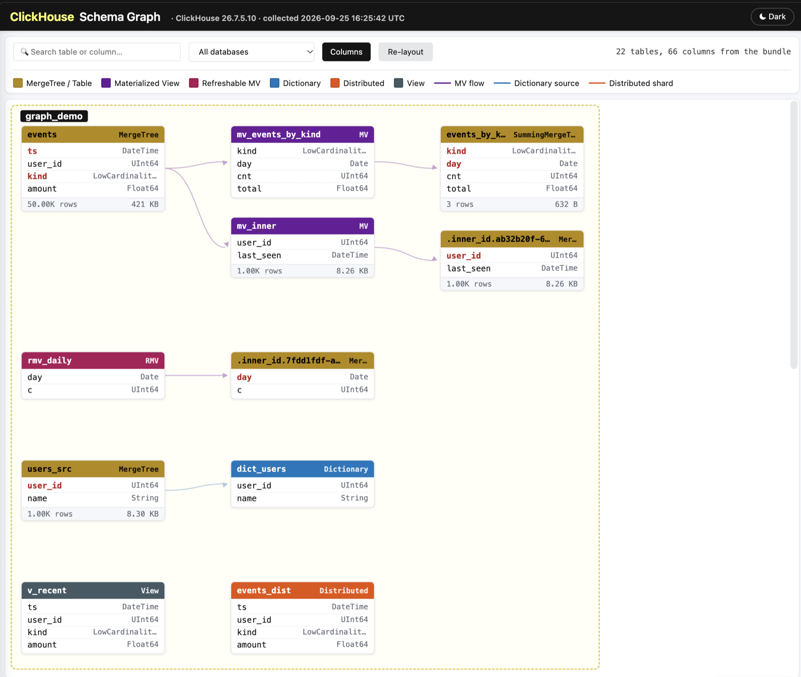

# Dashboard and schema graph

*Moved from the main [README](../README.md), which keeps a short version of each section.*

## Dashboard

When `-skip-dashboard` is not set, the tool generates a single self-contained `dashboard.html` inside the per-run results folder. The dashboard embeds all query results inline as JSON and loads only Chart.js from a CDN, so it can be opened from disk (`file://`) on any machine with internet access.

Every panel is built from the files the collectors already wrote (`internal/dashboard/fromfiles.go`): **no query is sent to the server after collection**, so the dashboard costs a struggling server nothing and shows exactly the window that was collected — `-from`/`-to` and an essential run's 1-day cap included. A panel whose source collector was skipped or failed is listed in the banner with the collector's name; one whose table this server does not have is hidden, as before. With `-output-format native` or `tsv` the panels query the server instead, as they did before. Differences from the live panels: the Part Log panels cover the collector's **3 days**, not 7; a cloud bundle's Replicas Health shows the serving replica's 200 most-affected tables (the `system.replicas` collector keeps the worst 200 per replica); and the schema graph's `CREATE` statements are the server's original single-line text (only a live `formatQueryOrNull` can pretty-print them).

### Sections

| # | Section | What it shows |
|---|---|---|
| 1 | 🚨 **Alert Summary** | Fired alerts grouped by severity (critical / warning / info), with the row-level message template expanded per instance. Long content collapses: a message is shown up to the ClickHouse stack trace (a real one runs 1700+ characters over 15 lines, of which ~200 are the error) and capped at 260 characters, with the complete text one click away under *full message and stack trace*; only the first 5 instances are listed, the rest behind *N more instances*; and a rule description shows its first paragraph, the rest under *more about this rule*. Nothing is dropped from the page — `DATA.alerts` still carries every row in full. Rules that **could not run** appear with a ⚠ marker and a separate "Could not run" chip — they are never counted in the severity badge. Rules that are **not applicable** here are listed in a muted footnote. A green "no issues" banner appears when nothing fired. |
| 2 | 📈 **Overview** | Top-level counters: server version, uptime, total databases, total tables, active parts, total size |
| 3 | 📦 **Storage** | Size by database (horizontal bar), table-engine distribution (doughnut), and a top-20-by-size table list |
| 4 | 📋 **Tables Explorer** | Searchable / paginated table of every user table with engine, parts, rows, size, partition / sorting keys, and storage policy |
| 5 | 📊 **Query Activity** (last 7 days) | Queries per hour by kind (stacked bar), count by kind, average duration & memory by kind |
| 6 | 🔍 **Query Deep Dive** (last 7 days) | Top 20 slowest query patterns (by avg duration), top 20 heaviest reads (avg MB/query), per-user executions & errors, slow-query details and per-user summary tables |
| 7 | ⚠️ **Exceptions** (last 7 days) | Top exception codes by count, plus an exception-details table with the most recent message per code |
| 8 | 🔧 **Part Log Events** (last 3 days — the collector's window) | Part events per day by event type (stacked bar) and event-type distribution |
| 9 | 📖 **Dictionaries** | Status distribution (LOADED / FAILED / LOADING), bytes allocated per dictionary, lifetime configuration (min/max), and a details table including `last_exception` (gov mode emits an empty value here) |
| 10 | 💥 **Crash Log** | Recent entries from `system.crash_log` — section is hidden when the table is empty |
| 11 | ⏳ **Pending Operations** | Pending mutations and detached-parts tables side by side |
| 12 | 🔄 **Replication Queue** | Current entries in `system.replication_queue` with type, table, and last exception |
| 13 | 🌐 **Cluster Nodes** (cloud mode only) | Hosts in the `default` cluster with shard / replica / active status |
| 14 | 🔁 **Replicas Health** | Replication-delay distribution, queue-size by table, per-replica details (only shown when replicated tables exist) |
| 14a | 🔑 **Keeper Health** (last 7 days) | Shown when `system.metric_log` has rows. Per hour: Keeper transactions (line) against hardware exceptions (bars coloured by verdict), mean request latency (`ZooKeeperWaitMicroseconds / ZooKeeperTransactions`), Keeper-dependent error codes (999 / 242 / 319 / 571 / 252 from `system.error_log` on 24.8+, else `query_log`), and the live `system.zookeeper_connection` rows. A verdict table applies the same rule as the `keeper_health` alert: > 1000 exceptions with traffic below 50 % of the 7-day median = unavailable; with traffic holding = blip. A **Keeper members** table, shown whenever `keeper/` is in the bundle (even without `metric_log`), lists what each member reports about itself — ensemble, state, role, version, Raft log first → last and committed vs leader-committed, latest snapshot, `snapshot_transfer_chunk_size`, snapshot format, bytes on disk — marked ⛔ / ⚠ by the same rules as the pre-pass's HC-3.18–3.20 (a test runs both readers on the same files and requires the same verdicts), with a banner when no member of an ensemble *in the bundle* is serving — which does not exclude voters outside it holding a quorum. Apache ZooKeeper's "This ZooKeeper instance is not currently serving requests" counts like Keeper's wording. |
| 15 | 💾 **Disk Usage** | Free vs used space per disk plus a disk-details table |
| 16 | 🛑 **Server Error Counters** | Top 20 cumulative error codes from `system.errors`, high-part-count partitions (>100 parts → potential code-252 `TOO_MANY_PARTS` risk), and TTL activity from `part_log` |
| 17 | ⚡ **Async Insert Activity** (last 24 h) | Flush count per hour by status — section is hidden when `system.asynchronous_insert_log` is empty or in gov mode |
| 18 | 🕸 **Schema Graph** | The table-dependency graph — tables, materialized views, dictionaries and Distributed tables with the edges data flows along — served from a second page, `schema_graph.html`, that the tab loads into a frame only when clicked. See *Schema graph* below. |

In addition, when `--query-id` or `--normalized-query-hash` is set, a **🔍 Query Analysis** section appears near the top of the nav. See [Query analysis mode](query-analysis.md#query-analysis-mode) for what it contains.

A sidebar on the left lists every section and highlights the one you are reading. The arrow at the left of the sticky header hides or shows it (the choice is remembered in the browser, like the theme); while hidden, the arrow shows the name of the current section. Sections that depend on cluster-specific or version-specific data (Crash Log, Cluster Nodes, Replicas Health, Async Inserts, Query Analysis) are hidden when there is nothing to show.

### Previewing the Keeper Health panel without an outage

`make dashboard-preview` renders three pages from anonymised fixtures. `bin/alerts_preview.html` exercises every Alert Summary collapse case — a message carrying a stack trace, more instances than the inline cap, a short message that needs no disclosure, a rule whose query failed, a rule that was not applicable. `bin/keeper_incident_preview.html` is shaped like a real Keeper outage on a shared-storage cluster: 48 hours of Keeper counters (a blip on day one, quorum lost for eight hours on day two), the `keeper_health`, `keeper_connection_blips`, `merges_stalled`, `background_operation_failures`, `high_exception_rate` and `too_many_parts` alerts as they would fire, the error codes per hour and a re-established Keeper session. Use it to see what the panel and the alerts look like before an incident, or to review a theme or wording change. `bin/schema_graph_preview.html` is a small fixture pipeline with every node kind — MergeTree source, MVs with explicit and implicit targets, a refreshable MV, a dictionary, a Distributed table, a view, and a table with credentials in its DDL — reachable from the preview dashboard's Schema tab.

### What's interactive vs static

- **Interactive**: Tables Explorer (full text search, database/engine filters, pagination); all charts (hover tooltips, legend toggling); the Alert Summary disclosures (native `
`, so they work without JavaScript and survive `Ctrl-F` only when open).
- **Static**: every other table — they render in a fixed order, but their underlying JSON is embedded in the page so you can `grep DATA dashboard.html | head` if you want raw values.

### The schema graph page

What the page looks like and what each element means is in [Schema graph](#schema-graph) above; this section is the design record.

`schema_graph.html` is written next to `dashboard.html` and is an adaptation of ClickHouse's own `/schema` page (`programs/server/schema.html`, Apache-2.0), with every live query replaced by JSON embedded at collection time: `system.tables`, `system.columns`, `system.dictionaries` and `system.view_refreshes`, system databases excluded. Nodes are coloured by engine (MergeTree, MV, refreshable MV, dictionary, Distributed, view); edges follow `dependencies_*` / `loading_dependencies_*` and — on 26.6+ — `target_table`, the only source that names the implicit `.inner_id.*` table of an MV declared with an `ENGINE`. Click a node for its keys, columns, neighbours and `CREATE` statement; search matches table and column names; drag, zoom and filter by database.

Why a second file: the graph needs every column of every user table embedded, and that grows with the schema — ~750 KiB on a near-empty server, tens of MB on a service with thousands of tables. Inlining it would slow `dashboard.html` for every reader. Instead the dashboard's **Schema Graph** tab assigns the file as an `<iframe>` source on the first click (a navigation, which `file://` permits, where `fetch()` of a sibling file is blocked), so nobody pays for the graph until they ask for it. The two pages share the theme through `localStorage`; the frame cannot be scripted across the `file://` boundary and does not need to be. If the frame stays blank, the bundle folder was not copied whole.

**Credentials.** `create_table_query`, `engine_full` and `system.dictionaries.source` carry engine arguments — an S3 secret key, a MySQL password, `kafka_sasl_password`. Servers from 23.x mask these as `'[HIDDEN]'` themselves; a 22.x server does not. Both the collected JSONL (`system.tables`, `system.dictionaries`) and the graph payload pass through a redactor (`internal/collection/sqlredact.go`) that masks the credential positions of every known engine and table function (S3-family, MySQL, PostgreSQL, MongoDB, `remote()`, Redis, Azure, …), plus the byte-shape heuristics the config sanitizer uses (URL basic-auth, AWS key ids, JWTs, `keyword = 'value'`), writing the server's own `[HIDDEN]` token so old and new bundles read alike. `execution_log.txt` notes how many values each collector replaced. This is field-level and JSONL-only: a `-output-format native|tsv` bundle carries the DDL unredacted and says so.

## Schema graph

Every run in `cloud` or `onprem` mode also writes **`schema_graph.html`** next to `dashboard.html`: an interactive map of how data flows through the schema, adapted from ClickHouse's own `/schema` page and rendered entirely from data captured at collection time — it works from disk with no server and no network.

- **One node per table**, grouped by database and coloured by engine: MergeTree family, materialized view, refreshable MV, dictionary, Distributed, view. Each node lists its columns (key columns in red, defaulted columns in green) and, for tables that hold data, the row count and size.
- **Edges follow the data.** A materialized view sits between the table it reads and the table it writes — including the implicit `.inner_id.*` table of an MV declared with an `ENGINE`; a dictionary points at its source table; a Distributed table at the shard table behind it. Chains are laid out left to right, deepest first, so the longest MV pipeline is what you see at the top. Where `system.tables` records no dependency — a refreshable MV, a plain view, a Distributed table — the source edge is **inferred from the DDL** (`FROM` / `JOIN`, or the Distributed engine arguments) and drawn **dashed**, and the sidebar says so.
- **The grey ribbon** under a node carries what you would otherwise open the DDL for: row count and size for a table; for a refreshable MV its schedule — `EVERY 2 MINUTE OFFSET 30 SECOND RANDOMIZE FOR 10 SECOND` — with the schedule underlined when there is **no** `RANDOMIZE FOR`, so thirty views that all fire at the same instant read as thirty underlines; for a dictionary its `LIFETIME`; for a table the number of data-skipping indices.
- **Column names show their role**, not one red: primary key bold red, sorting-only red, partition key dotted-underlined amber, sampling key dashed teal, defaulted columns green — a column can carry several. The sidebar tags each column `PRIMARY KEY` / `ORDER BY` / `PARTITION BY` / `SAMPLE BY` and lists the skip indices with type, expression and granularity.
- **Click a node** for its keys, partitioning, full column list, the tables it reads from and writes to, refresh schedule and status for a refreshable MV, dictionary lifetime, status and last error, and the `CREATE` statement — the server's original text (the page is built from the collected files after collection, and only a live `formatQueryOrNull` can pretty-print it), syntax-highlighted on the page, with credentials in engine arguments shown as `[HIDDEN]`.
- **Search** matches table *and* column names and dims everything else; filter to one database; drag nodes, zoom, re-layout; keyboard users can Tab to a node and press Enter.

Open it from the dashboard's **Schema Graph** tab — the page loads into the frame only when you click, so nobody pays for it otherwise — or open the file directly from the bundle folder. Why it is a separate file, how the two pages share a theme, and what the credential redaction covers is under [Dashboard → Schema graph](#the-schema-graph-page).
